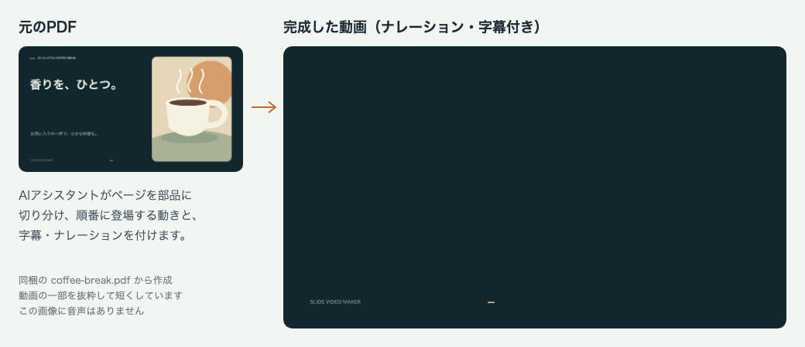
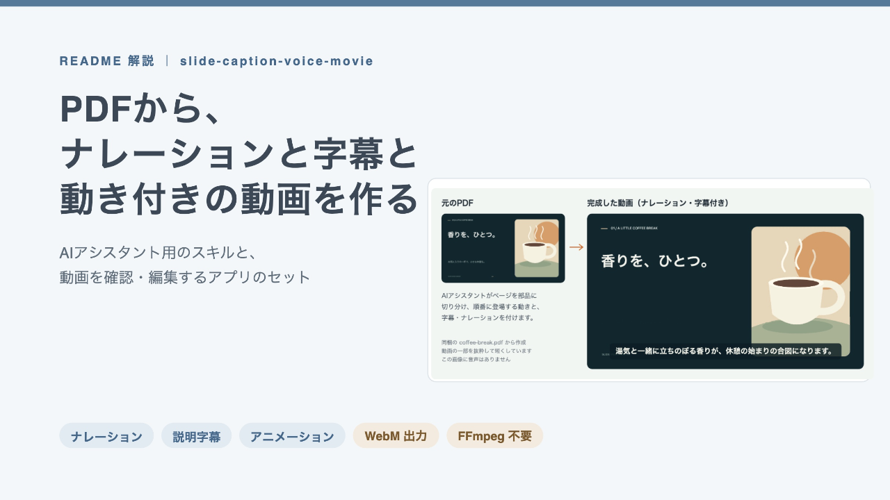
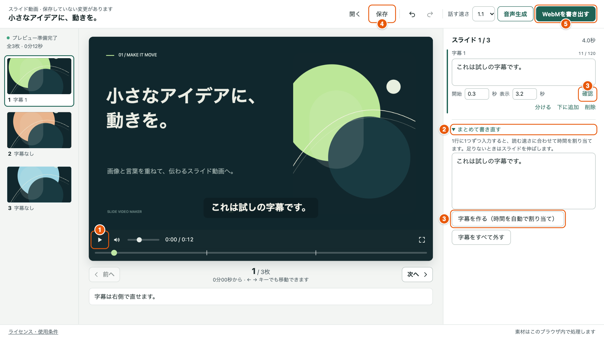
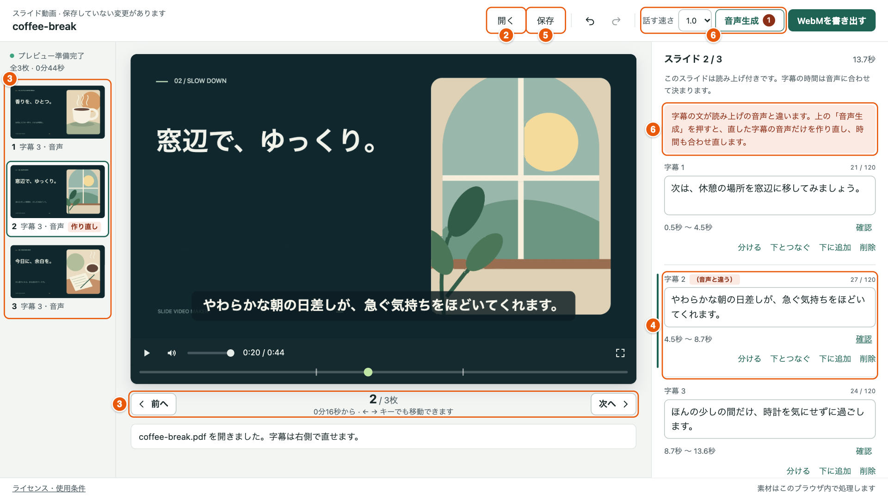

# PDFから、ナレーションと字幕と動き付きの動画を作る

**PDF資料から、ナレーション・説明字幕・アニメーション付きの動画を作るツールです。** AIアシスタント用のスキル（制作手順）と、動画を確認・編集するアプリがセットになっています。

- **AIスキル**：AIアシスタントがPDFを読み取り、字幕・ナレーション・動きを付けて動画を書き出します。
- **アプリ**：ブラウザで動画を確認し、字幕や音声を直して保存・再書き出しできます。



## 解説動画（YouTube）

このツール自身で作成したREADMEの解説動画です。画像をクリックするとYouTubeで再生されます。

[](https://youtu.be/FHmQewTbcco)

- [YouTubeで解説動画を見る](https://youtu.be/FHmQewTbcco)

## 特徴

- **PDF全体を1本の動画に** — 見出しやイラストに、説明に合わせた動きを付けます。
- **ナレーションと字幕付き** — 字幕の文を読み上げた音声を付けます。音声なしの動画にもできます。
- **字幕と音声は画面で手直し** — 字幕の文を直して音声を作り直し、動画を書き出せます。
- **完成動画はWebM形式** — Google Chromeで再生できます。MP4出力には対応していません。
- **FFmpegなしで書き出し** — 動画変換ソフトを別に入れなくても、Chromeの機能で動画を作れます（[コーデックの利用方針](docs/CODEC_POLICY.md)）。

AIスキルは、IBM Bob・Claude Codeなど、ローカルのファイルを読み書きし、コマンドを実行できるAIアシスタントで利用できます。

### 読み進め方

- まず動きを見たい方 → [デモで試す](#デモで試す)
- 自分の資料を使う方 → [自分のPDFを動画にする](#自分のpdfを動画にする)
- うまくいかないとき → [困ったとき](#困ったとき) / [詳しい使い方](docs/REFERENCE.md)

## 前提条件

デモの再生・字幕の編集・動画の書き出しには、次のものを用意してください。

| 必要なもの | 目安 |
|---|---|
| Google Chrome | 最新版。アプリを開くブラウザに使います |
| [Node.js](https://nodejs.org/ja) と npm | Node.js 22.13以降の22系、または24系。npmはNode.jsに付属します |

自分のPDFからナレーション・字幕・動きを作るときは、さらに次のものを用意してください。

- **IBM Bob・Claude CodeなどのAIアシスタント**：ローカルの画像やファイルを読み取り、JSONを書き込み、コマンドを実行できるものを使います。画像を確認できるモデル・ツールを利用してください。
- **Irodori-TTSのサーバー**（[Irodori-TTS-Server](https://github.com/Aratako/Irodori-TTS-Server)）：文章を音声にする読み上げソフトです。**ナレーションを付けるときだけ**必要です（音声なしで作る場合は不要です）。サーバーの立て方は「[Irodori-TTS を Cloud Run の L4 GPU で動かす](https://qiita.com/c_u/items/af76445d177515ed7903)」（Qiita）を参照してください。

**デモを試すだけなら、AIアシスタントやIrodori-TTSの準備は不要です。** アプリにAPIキーを設定する必要はありません。初回のパッケージのインストールにはインターネット接続が必要です。AIアシスタントやIrodori-TTSの利用環境・接続・料金は、利用するサービスに従います。

## デモで試す

### 1. プロジェクトをダウンロードする

このGitHubページの **Code → Download ZIP** からダウンロードし、ZIPを展開します。すでに手元にフォルダーがある場合は、そのフォルダーを使ってください。

### 2. アプリを起動する

ターミナル（コマンドを入力するアプリ）で、展開したフォルダーへ移動します。Macでは `cd ` と入力し、フォルダーをターミナルへドラッグしてEnterを押すと移動できます。Windowsでは、展開したフォルダーをエクスプローラーで開き、アドレス欄に `powershell` と入力してEnterを押す方法もあります。

次のコマンドを、1行ずつ実行してください。

```sh
npm ci
npm run dev
```

- `npm ci` は、必要な部品をインストールします。初回に実行します。実行前に影響を確認したい方は「[npm ciで起きることとリスク](#npm-ciで起きることとリスク)」をご覧ください。
- `npm run dev` は、アプリを起動します。次回からはこちらだけで起動できます。

ブラウザが自動で開きます。Chrome以外が開いた場合は、ターミナルに表示されたアドレスをChromeで開いてください。起動中はターミナルを開いたままにします。

### 3. デモを開いて、動画にしてみる

Chromeのアドレスの末尾に **`/?sample=demo`** を付けます。

例：`http://127.0.0.1:5173/?sample=demo`（ポート番号は、起動時に表示されたものに合わせてください）

画像の番号は、下の手順の番号と対応しています。



1. **▶** を押して、3枚・約12秒のデモを再生します。この組み込みデモには、確認用の音が入っています。
2. 右側の **「まとめて書き直す」** に、試しの字幕を1行入力します。
3. **「字幕を作る（時間を自動で割り当て）」** を押し、**「確認」** で表示を見ます。
4. **「保存」** で編集用データを保存します。
5. **「WebMを書き出す」** を押して、動画ファイルを保存します。

終了するときは、ターミナルで **Control + C** を押してください。

## 自分のPDFを動画にする

**PDFの取り込みと動画の組み立ては、AIアシスタントに頼みます。** ブラウザの「開く」は、作成済みのプロジェクト（JSON）を読み込むボタンです。

### 1. PDFを用意する

PDFをプロジェクトのフォルダーに置きます。**40MB・60ページ以内、パスワードなし**のPDFが対象です。

まずは、同梱の **`user-test/coffee-break.pdf`**（3ページ）で試せます。自分の資料を使うときは、以下の依頼文のPDFのパスを置き換えてください。

### 2. ナレーションの準備（Irodori-TTS）

**ナレーションなしでよければ、この手順は飛ばせます。** 準備がむずかしい場合は、まず音声なしで作り、後から音声を付けることもできます。

ナレーションを付けるには、[Irodori-TTS-Server](https://github.com/Aratako/Irodori-TTS-Server) を手元のPC、またはGoogle Cloud Runなどで起動しておきます。Cloud Runでの立て方は「[Irodori-TTS を Cloud Run の L4 GPU で動かす](https://qiita.com/c_u/items/af76445d177515ed7903)」（Qiita）で紹介しています。

- **手元のPCで `http://localhost:8088` に起動した場合**：設定は不要です。
- **それ以外の場所で起動した場合**：プロジェクトのフォルダーに `.env.local` という名前のファイルを作り、サーバーのアドレスを書きます。

  ```sh
  IRODORI_URL=https://（サーバーのアドレス）
  ```

声の種類・話す速さ・認証（Cloud Runなど）の設定は、「[詳しい使い方](docs/REFERENCE.md#ナレーションirodori-tts)」をご覧ください。

### 3. IBM Bob / Claude に頼む

IBM Bob・Claude Codeで、このプロジェクトのフォルダーを開きます。まだ `npm ci` を実行していなければ、先に実行してください。IBM Bobの方は、チャットを **Agentモード** にしてください（詳しくは「[IBM Bobで使う](docs/IBM_BOB.md)」をご覧ください）。

次の依頼文を、そのままチャットに貼り付けます。

```text
/slide-caption-voice-movie user-test/coffee-break.pdf をナレーションと字幕付きの動画にしてください。動きはなるべく多めにしてください。
```

アシスタントが、ページの確認 → 字幕と動きの作成 → ナレーションの作成 → 動画の書き出しを進めます。ページ数や内容によって、数分以上かかることがあります。Irodori-TTSにつながらないときは、音声なしの動画を作り、その理由を報告します。

### 4. 完成したファイルを開く

コーヒーのサンプルでは、次の場所に保存されます。

| ファイル | 使い方 |
|---|---|
| `output/coffee-break/coffee-break-voice.webm` | 完成動画。Chromeへドラッグすると再生できます |
| `output/coffee-break/coffee-break-voice.json` | 編集用データ。アプリの「開く」で読み込みます |

保存先は、アシスタントの完了報告でも確認できます。自分のPDFの場合は、PDFの名前に応じたフォルダーになります。音声なしで作った場合、編集用データは `coffee-break-captions.json` になります。

**動画を見るならWebM、あとで字幕を直すならJSON。** JSONも一緒に残しておくと、後から編集できます。

## 字幕を直して保存する

画像の番号は、下の手順の番号と対応しています。



1. `npm run dev` でアプリを起動し、Chromeで開きます。
2. **「開く」** で、編集したいJSONを読み込みます。
3. **「前へ」「次へ」** やスライド一覧で、直したいページを選びます。
4. 右側で字幕の文を直し、**「確認」** で表示を見ます。
5. **「保存」** で編集後のJSONを保存します。**自動保存はありません。**
6. **「音声生成」** を押すと、直した字幕の音声を作り直します。終わったら、もう一度 **「保存」** します。

最後に **「WebMを書き出す」** で、修正を反映した動画を保存します。

音声なしのスライドでは、字幕の開始時刻・表示秒数も画面で直せます。複数の字幕を作り直す場合は、「まとめて書き直す」に1行1つずつ入力してください。読む速さに合わせて表示時間を割り当て、必要ならスライドの時間を伸ばします。

各字幕の下の「分ける」「下とつなぐ」「下に追加」で、字幕を分けたり足したりできます。間違えたときは、ヘッダーの矢印（`⌘Z` / `Ctrl+Z`）で元に戻せます。キー操作などの一覧は「[画面でできること](docs/REFERENCE.md#画面でできること)」にあります。

画面で変更できるのは字幕とその音声です。動きや読み方を直すときは、対象のJSONを示してAIアシスタントに頼みます。画面で字幕を編集した場合は、保存した最新のJSONを渡してください。

```text
2枚目の太陽を、もう少しゆっくり登場させてください。
```

```text
AWSは「エーダブリューエス」と読んでください。音声を作り直して、WebMも書き出し直してください。
```

## 困ったとき

| 状況 | 対処 |
|---|---|
| `npm` が見つからない | Node.jsをインストールし、ターミナルを開き直してください。`node -v` と `npm -v` で確認できます |
| `package.json` が見つからない | コマンドを実行する場所を確認してください。READMEと `package.json` が入っているフォルダーで実行します |
| Bobが説明だけしてファイルを作らない | Agentモードに切り替え、ファイル変更・コマンド実行の承認待ちがないか確認してください |
| AIアシスタントが手順書を使わずに進める | 依頼文の先頭に `/slide-caption-voice-movie` を付けてください |
| ナレーションが付かず、無音の動画になった | Irodori-TTSのサーバーが起動しているか、`.env.local` の `IRODORI_URL` が正しいかを確認してください。Cloud Runでは `gcloud auth application-default login` などの認証が必要です。直したら「音声を作り直して」と頼みます |
| 最初の音声作成に時間がかかる | Cloud Runで0台から起動する場合、最初の1回は1〜2分かかります |
| 英語や略語の読み方がおかしい | 「AWSは『エーダブリューエス』と読んで」のようにAIアシスタントに頼むと、読み方辞書に登録して音声を作り直します |
| 字幕の時間を画面で変えられない | ナレーション付きのスライドでは、時間は音声に合わせてあるため変更できません。文を直して保存し、「音声生成」を押すか「音声を作り直して」と頼んでください |
| 字幕に「音声と違う」と表示される | 字幕の文と読み上げの音声が一致していません。「音声生成」を押すか、保存したJSONをAIアシスタントに渡して「音声を作り直して」と頼んでください |
| `Google Chrome` が見つからないというエラーになる | 同じPCにGoogle Chromeをインストールしてください。CLIはPlaywrightの `channel: 'chrome'` で起動するため、別のブラウザだけでは実行できません |
| 「起動時のプロジェクトがありません」と出る | 初回は正常です。アドレス末尾に `/?sample=demo` を付けるか、「開く」でJSONを読み込んでください |
| ブラウザが開かない・再接続できない | ターミナルで `npm run dev` が動いているか確認し、そこに表示されたアドレスをChromeで開いてください |
| `/?sample=coffee` などのサンプルが開けない | 組み込みデモは準備不要です。それ以外のサンプルは `npm run samples:prepare` で生成します（ChromeとPython 3が必要です） |
| PDFを「開く」で選べない | PDFはAIアシスタントに渡します。「開く」で選ぶのは編集用のJSONです |
| 保存・書き出しができない | 空の字幕や、字幕の表示時間の重なりなど、画面に表示された警告を修正してください |
| ブラウザが非対応と表示される | 最新版Chromeを使い、ターミナルに表示された `http://127.0.0.1:…` のアドレスで開いてください |
| 長い動画の書き出しに時間がかかる | 完了を待ってください。端末のメモリや空き容量が必要です。画面の進捗とエラー表示も確認してください |

## npm ciで起きることとリスク

`npm ci` は、`package-lock.json` に記録された版の部品を、このプロジェクトの `node_modules` フォルダーへインストールするコマンドです。

### 起きること

- 既存の `node_modules` を削除して作り直します。PDFや `output/`・`.env.local` など、ほかのファイルは変更しません。
- npmの公開サービス（`registry.npmjs.org`）から部品をダウンロードします。macOS（Apple Silicon）では38個・約200MBです。OSによって、入る部品は変わります。
- `package.json` と `package-lock.json` は書き換えません。2つの内容が食い違っている場合は、インストールせずにエラーで止まります。
- インストール先はこのフォルダーの中だけです。PC全体への導入や、Google Chrome・Irodori-TTSのダウンロードは行いません。

### リスクと対処

| リスク | 内容 | 対処 |
|---|---|---|
| 第三者のプログラムが入る | 部品は、`npm run dev` などで実行すると自分のユーザー権限で動き、PC内のファイルやネットワークを扱えます。`npm ci` のハッシュ照合で分かるのは、記録時と同じ内容かどうかだけで、安全性の保証ではありません | 機密情報を扱うPCでは、所属組織のルールに従って実行するか、業務データのない環境で試してください |
| 中身を読みにくい部品がある | 動画のビルドなどに使う部品の一部は、コンパイル済みのプログラム（`.node`）です | 上と同じです |
| 入手元が違うコピーを使う | フォルダーの中身が改変されていると、`package-lock.json` やコマンドの定義も信頼できません | 正規のGitHubページからダウンロードしてください |
| 後から脆弱性が見つかる | 版を固定しているため、部品に問題が見つかっても自動では更新されません。2026年11月9日時点の `npm audit` では0件です | ときどき `npm audit` で確認してください。脆弱性が報告された場合は、結果をお手持ちのAIアシスタントに見せて、影響と対処を相談してください |
| `node_modules` の変更が消える | 中身を手で変更していた場合、その変更は元に戻せません | 通常の利用では `node_modules` を変更しないでください |
| 通信や容量の不足で失敗する | インターネット接続と空き容量が必要です。社内ネットワークでは接続が制限されている場合があります | 原因を解消して、もう一度 `npm ci` を実行してください |

現在の部品には、インストール中に独自の処理を実行するスクリプトの定義はありません。新しいnpmでは `fsevents` について `install scripts` の警告が表示されることがありますが、これが表示されてもインストールは完了します。

## 対応する資料と出力形式

| 項目 | 対応範囲 |
|---|---|
| 入力PDF | 40MB・60ページ以内、パスワードなし |
| 字幕 | 1スライド20個まで、1個120文字・手動改行を含め12行以内 |
| ナレーション | 字幕1つを1区切りとして読み上げ、24kHzのWAVとしてプロジェクトに埋め込みます。字幕は読み上げている間だけ表示されます |
| 動画の長さ | 1スライド1〜60秒、全体60分以内。ナレーション付きは全体20分以内 |
| 完成動画 | WebM形式、1280×720、30fps。映像はVP8、音声はOpus |
| 音声入力 | 非圧縮WAVのみ。64MB・20分以内 |
| プロジェクト（JSON） | アプリの「開く」で読み込めるのは200MBまで |

長い動画の書き出しには、時間とメモリ・空き容量が必要です。写真やグラデーションの上にある物など、切り分けが難しいページは、ページ全体に寄る・引くなどの動きを付けます。

## もっと詳しく

- [詳しい使い方・コマンド・技術仕様](docs/REFERENCE.md)：画面の操作、ナレーションの設定、手動コマンド、アニメーション、開発・テスト・配布の手順
- [IBM Bobで使う](docs/IBM_BOB.md)
- [Irodori-TTS を Cloud Run の L4 GPU で動かす](https://qiita.com/c_u/items/af76445d177515ed7903)（Qiita）：ナレーション用の読み上げサーバーの作り方
- [サンプルPDFで試す手順と確認項目](user-test/README.md)
- [AIアシスタント用の制作手順](.claude/skills/slide-caption-voice-movie/SKILL.md)
- [第三者ライセンス](THIRD_PARTY_NOTICES.md) / [コーデックの利用方針](docs/CODEC_POLICY.md)
- [参考：字幕だけの無音動画版](https://github.com/cu0001/slide-caption-silent-movie)

このアプリは、AI（Claude、IBM Bob、Codex）との壁打ちを重ねて作成しました。

プロジェクトの独自コードと独自デモ素材は [MITライセンス](LICENSE) です。依存関係と配布時の注意は、上記のライセンス資料にまとめています。
